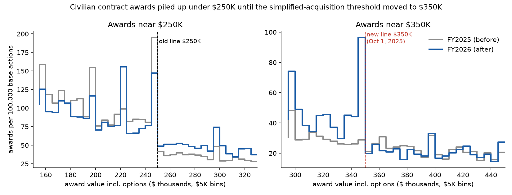
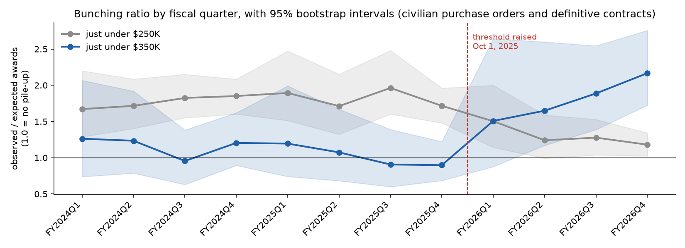
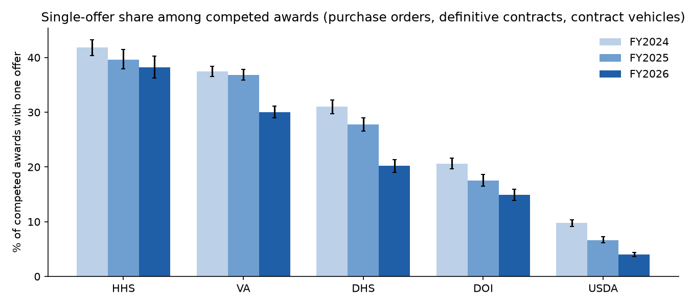

# Federal Procurement Integrity Observatory

An open, reproducible look at how competitive US federal contracting is. It tests whether buying behavior bunches around legal dollar thresholds, and publishes **pre-registered forecasts** that are scored in public when the answers come in.

Everything here is built from free public data (USAspending.gov and SAM.gov), runs on a laptop, and can be rerun from the scripts in this repository.

> **Status (October 24, 2026):** first working version. It covers five civilian departments (VA, HHS, DHS, Interior and USDA) for FY2024–FY2026, plus the civilian-wide threshold test. Defense data is excluded for now because of DoD's 90-day reporting delay.

---

## Key findings

### 1. When the simplified-acquisition threshold moved, the pile-up of contracts moved with it

On October 1, 2025, the simplified-acquisition threshold (the dollar line below which agencies can use faster, simpler buying procedures) rose from **$250,000 to $350,000**. Before the change, civilian awards piled up just under $250K. In the year after, the pile-up under $250K shrank and a new one formed just under $350K.



| Line | Bunching ratio, FY2025 (before) | FY2026 (after) | Change (95% interval) |
|---|---|---|---|
| Just under **$250K** (old line) | 1.79 | 1.24 | **−0.55** (−0.75 to −0.35) |
| Just under **$350K** (new line) | 0.97 | 1.95 | **+0.99** (+0.64 to +1.42) |
| Placebo line $200K | 1.46 | 1.30 | −0.15 (−0.41 to +0.11) |
| Placebo line $450K | 0.86 | 1.02 | +0.15 (−0.12 to +0.43) |

The bunching ratio compares the awards observed just under a line with the number a smooth curve fitted outside that window predicts. A value of 1.0 means no pile-up. The placebo lines, where nothing changed, did not move.

The new pile-up grew every quarter after the change: 1.51 → 1.65 → 1.89 → 2.17.



Pile-ups under a threshold are a well-known risk indicator. They can mean contract values are being set to fit simpler procedures, or contracts are being split. They can also have ordinary explanations, such as budgets and requirements written to fit the rules. **This analysis measures the pattern. It does not establish why it happens.**

### 2. About one in four competed awards received a single offer

Among 97,643 competed awards with a usable offer count (purchase orders, definitive contracts and contract vehicles, FY2024–FY2026):

- **22.8%** received exactly one offer (95% interval 22.5–23.0%).
- By department: HHS **40.3%**, VA **35.3%**, DHS **26.6%**, Interior **17.9%**, USDA **6.5%**.
- Weighted by dollars (purchase orders and definitive contracts), the share is **15.7%**, close to GAO's figure of about 13% for FY2005–2009.
- The share fell in every department from FY2024 to FY2026.



### 3. A forecast of which open solicitations will get only one offer

A transparent logistic-regression model uses only information known when a solicitation is posted: department, product and service codes, industry, set-aside type, notice type, response window, and the buying office's past single-offer rate. It was trained on awards through September 2025 and tested on FY2026 awards it had never seen:

| Model | AUC | Brier score |
|---|---|---|
| Department-wide rate (baseline) | 0.62 | 0.120 |
| Office history only | 0.65 | 0.122 |
| **This model** | **0.75** | **0.112** |

The model was then applied to **150 currently open solicitations** with response deadlines between Nov 1 and Dec 15, 2026. Those forecasts are sealed below.

---

## Pre-registered forecasts

Forecasts were made on **2026-10-24** and fingerprinted with SHA-256 before any outcome was known. See [`forecasts/`](forecasts/).

| ID | What it forecasts | Resolves | SHA-256 |
|---|---|---|---|
| PIO-F1 | Probability of a single offer for each of 150 open civilian solicitations | 2027-03-31 (checks Jan 31 and Feb 28) | `a8d1bb3319bf2fc1439550ee99c971742408a99a4772db426b26dec15f0657d2` |
| PIO-F2 | FY2027 Q1 bunching ratios under $350K (2.03; 80% interval 1.40–2.66) and $250K (1.23; 0.88–1.58), plus the micro-purchase reporting share | 2027-02-28 | `5a7009ba0f17e953bd1fea32d2b7fe9241a849b85222266506c5312e4790c43b` |

- **PIO-F2** is published in full.
- **PIO-F1** includes office-level details, so only its fingerprint is published for now. The full file will be posted with the scoring. Anyone can then check it against the fingerprint above.

To verify a published forecast file:

```bash
sha256sum forecasts/PIO-F2-threshold-fy2027q1-20261024.json
```

---

## How it works

| Step | Script | What it does |
|---|---|---|
| 1 | `01_download_usaspending.py` | Contract transactions for the five departments, FY2024–FY2026 (USAspending download API, selected columns only) |
| 1b | `01b_download_threshold_universe.py` | Purchase orders and definitive contracts for all civilian agencies (threshold test) |
| 2 | `02_build_awards.py` | One row per award, using the base action (modification 0) |
| 3 | `03_atlas.py` | Single-offer shares by department, year, award type, set-aside and size |
| 4 | `04_threshold.py`, `04b_threshold_quarterly.py`, `bunching_lib.py` | Bunching estimates with bootstrap intervals and placebo lines |
| 5–7 | `05_sam_open_pull.py`, `06_sam_open_details.py`, `07_sam_train_lookup.py` | Open solicitations and historical response windows from SAM.gov |
| 8 | `08_model_forecast.py` | Model training, out-of-time test, live probabilities |
| 9–12 | `09_…`, `10_…`, `11_…`, `12_…` | Pre-registration, resolution backtest and scoring |
| — | `make_figures.py` | The charts in this README |

Details, definitions and data-quality notes are in [`docs/methodology.md`](docs/methodology.md).

### Run it yourself

```bash
python -m venv .venv && source .venv/Scripts/activate    # Windows Git Bash; use bin/activate on macOS/Linux
pip install -r requirements.txt
export PIO_CONTACT="you@example.com"                      # contact address sent with requests (polite use)
python -I scripts/01_download_usaspending.py
# ... then 01b, 02, 03, 04, 04b, 05, 06, 07, 11, 08 in that order (see each script's header for options)
python -I scripts/make_figures.py
```

Scripts `10_preregister.py` and `10b_preregister_threshold.py` create *new* sealed forecasts. Don't rerun them unless you mean to register new forecasts. The registered ones are in `forecasts/`.

A full rerun downloads about 110 MB and takes about two hours, almost all of it waiting on servers at one request per second. The analysis itself takes a few minutes. No GPU is needed.

---

## Limits

- **No unit prices.** Federal award data records dollar values, not quantities or unit prices, so the price premium of single-offer awards can't be measured directly. A preliminary check found single-offer awards are 27% *smaller* within comparable categories, and found no detectable difference in post-award growth.
- **Offer counts are entered by staff.** 760 competed awards carry a "999" placeholder and were excluded.
- **FY2026 is unusual.** It saw a government shutdown, a reporting-system move and staffing changes. HHS and VA award counts fell 30–50% from FY2024.
- **SAM.gov's public search endpoint is undocumented.** This project uses it politely, at about one request per second. The documented alternatives are SAM's API (key required) and its daily CSV extract.
- **Coverage:** five civilian departments for the single-offer analysis; DoD is excluded.

## Responsible use

These numbers describe **markets and procurement patterns, not people**. A high single-offer rate or a pile-up under a threshold is a signal worth a closer look. It is not evidence of wrongdoing, and many have ordinary explanations. No individuals are named or stored. Contact details in SAM.gov records are never saved.

Office-level tables are left out of this first release until the method has been reviewed by a procurement practitioner.

Found an error? Please [open an issue](../../issues).

## Data sources

- [USAspending.gov](https://www.usaspending.gov) API and download service (US Treasury; public domain)
- [SAM.gov](https://sam.gov) contract opportunities (GSA; public)
- [Federal Acquisition Regulation](https://www.acquisition.gov/far) threshold history

## About

Built by **Ellie Burress** with AI assistance: Claude Code (an AI coding assistant) wrote most of the code and analysis for this first version. Questions, corrections and suggestions are welcome.

**License:** code under the [MIT License](LICENSE). Text, figures and result tables under [CC BY 4.0](https://creativecommons.org/licenses/by/4.0/). The underlying government data is in the public domain.
