# Federal Contract Competition: Findings & Forecasts

[](https://codespaces.new/e-burress/federal-contract-competition) · [Dashboard](https://e-burress.github.io/federal-contract-competition/) · [Explorer](https://e-burress.github.io/federal-contract-competition/explorer.html) · [One-page brief](https://e-burress.github.io/federal-contract-competition/brief.html) · [Run it yourself](docs/run-it-yourself.md)

An open, reproducible look at how competitive US federal contracting is. It tests whether buying behavior bunches around legal dollar thresholds, and publishes **pre-registered forecasts** that are scored in public when the answers come in.

Everything here is built from free public data (USAspending.gov and SAM.gov), runs on a laptop, and can be rerun from the scripts in this repository. Every number in this README is written by `scripts/build_report.py` from the result files.

<!-- auto:status -->
> **Status (November 9, 2026):** every result was rebuilt from one public data snapshot, [`data-2026-11-09`](https://github.com/e-burress/federal-contract-competition/releases/tag/data-2026-11-09), downloaded from USAspending on November 9, 2026. `python run.py quick` downloads it and rebuilds everything. The first release (October 24, 2026) used an earlier download that was not kept. Rebuilt from this snapshot, single-offer shares moved by at most 0.05 percentage points (five departments: 97,643 → 97,672 awards, still 22.8%) and bunching ratios by at most 0.02 ($350K after the change: 1.95 → 1.96). The first forecast model (version 1) and the sealed forecasts PIO-F1 and PIO-F2 are from October 24, 2026 and are unchanged.
>
> The in-depth analysis and the forecasts cover five civilian departments (VA, HHS, DHS, Interior and USDA) for FY2024–FY2026. Single-offer shares cover every civilian agency, and the threshold test is civilian-wide. These FY2024–FY2026 tables leave out Defense because of DoD's 90-day reporting delay.
>
> **Long history, in progress:** findings 4 to 10 add civilian agencies and Defense from FY2008 on. The single-offer history now uses FY2008–FY2021. FY2022–FY2026 are still to come. Each finding names the fiscal years it uses, which can differ while the history is being built.
<!-- /auto:status -->

---

## Key findings

### 1. When the simplified-acquisition threshold moved, the pile-up of contracts moved with it

On October 1, 2025, the simplified-acquisition threshold (the dollar line below which agencies can use faster, simpler buying procedures) rose from **$250,000 to $350,000**. Before the change, civilian awards piled up just under $250K. In the year after, the pile-up under $250K shrank and a new one formed just under $350K.

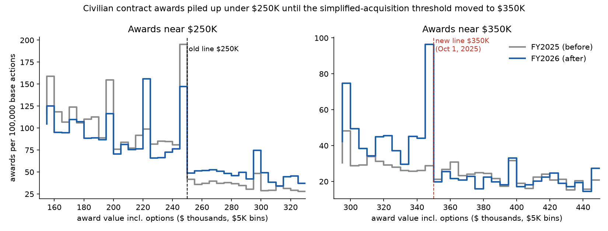

<!-- auto:threshold-table -->
| Line | Bunching ratio, FY2025 (before) | FY2026 (after) | Change (95% interval) |
|---|---|---|---|
| Just under **$250K** (old line) | 1.79 | 1.24 | **−0.55** (−0.74 to −0.37) |
| Just under **$350K** (new line) | 0.97 | 1.96 | **+0.99** (+0.65 to +1.36) |
| Placebo line $200K | 1.46 | 1.31 | −0.15 (−0.38 to +0.10) |
| Placebo line $450K | 0.86 | 1.02 | +0.16 (−0.13 to +0.44) |
<!-- /auto:threshold-table -->

The bunching ratio compares the awards observed just under a line with the number a smooth curve fitted outside that window predicts. A value of 1.0 means no pile-up. The placebo lines, where nothing changed, did not move.

<!-- auto:threshold-quarters -->
The new pile-up grew every quarter after the change: 1.51 → 1.65 → 1.90 → 2.18.
<!-- /auto:threshold-quarters -->

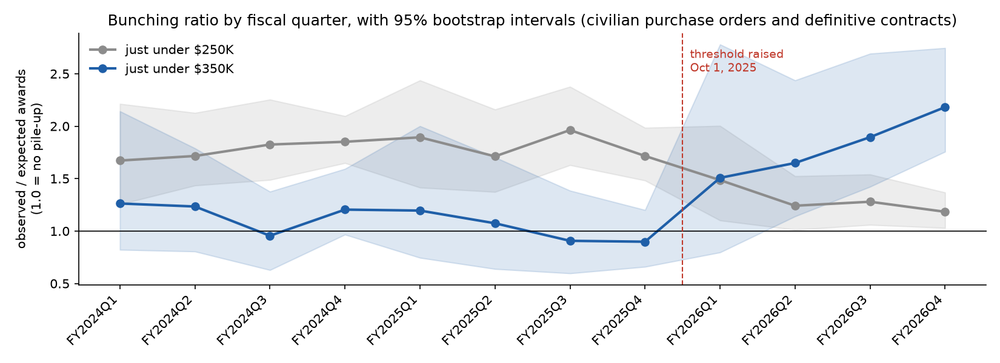

Pile-ups under a threshold are a well-known risk indicator. They can mean contract values are being set to fit simpler procedures, or contracts are being split. They can also have ordinary explanations, such as budgets and requirements written to fit the rules. **This analysis measures the pattern. It does not establish why it happens.**

### 2. About one in four competed awards received a single offer

<!-- auto:single-offer-five -->
Among 97,672 competed awards with a usable offer count (purchase orders, definitive contracts and contract vehicles, FY2024–FY2026):

- **22.8%** received exactly one offer (95% interval 22.5–23.0%).
- By department: HHS **40.3%**, VA **35.3%**, DHS **26.6%**, Interior **17.9%**, USDA **6.6%**.
- Weighted by dollars (purchase orders and definitive contracts), the share is **15.7%**, close to GAO's figure of about 13% for FY2005–2009.
- The share fell in every department from FY2024 to FY2026.
<!-- /auto:single-offer-five -->

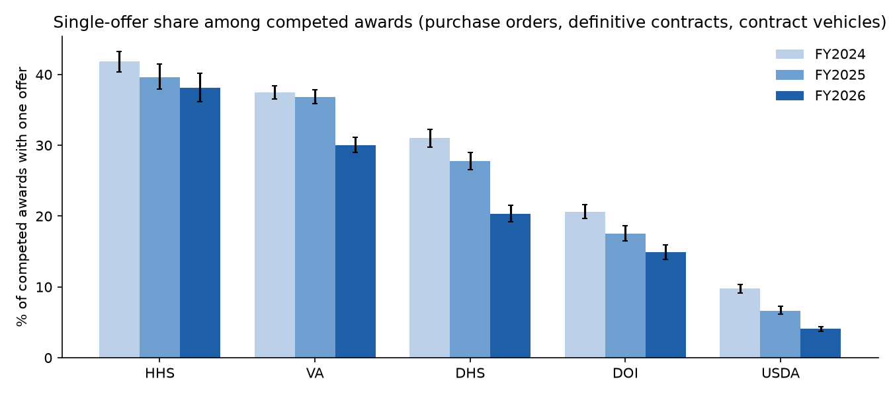

**Every civilian agency** (same definitions, same data snapshot):

<!-- auto:civilian -->
- Across all 64 civilian agencies with competed awards, **34.0%** of 466,009 competed awards got a single offer.
- **GSA** accounts for 63% of those awards. Almost all are very small purchase orders from GSA's Federal Acquisition Service, mostly supply orders (median award $143), and their offer coding changed sharply: one offer on 56% of them in FY2024, 17% in FY2026. So the civilian-wide figure is also given **without GSA: 25.5%** of 170,687 awards (FY2024 27.9% → FY2025 26.3% → FY2026 21.5%).
- Outside GSA and the five departments above, the share is **29.1%** (73,015 awards).
- Measured from the civilian-wide table, the five departments match the five-department table exactly.
<!-- /auto:civilian -->

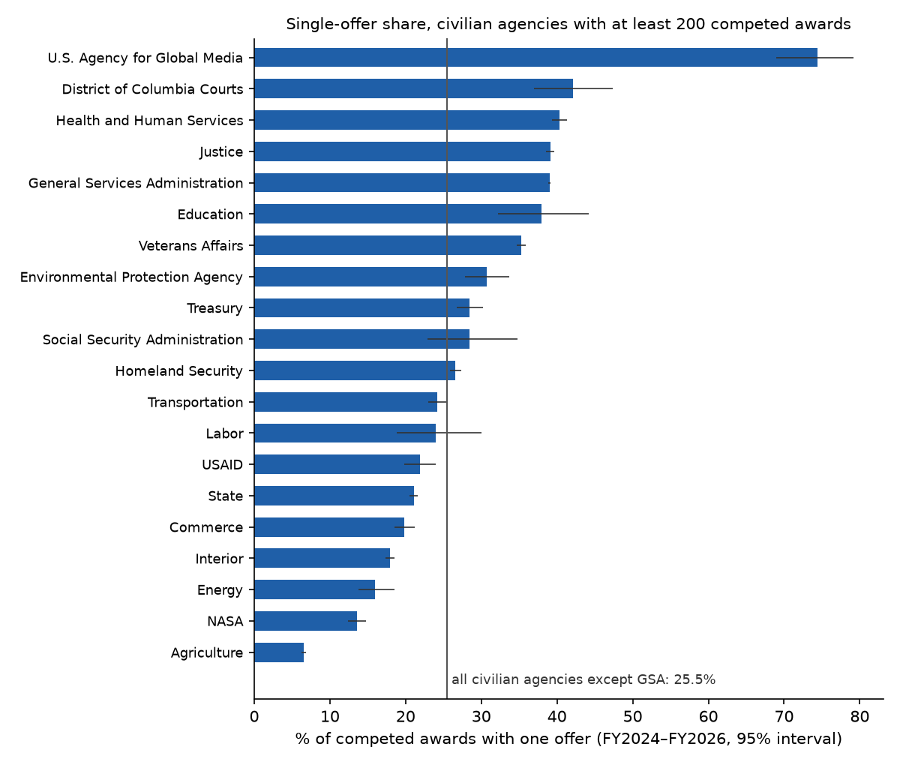

<!-- auto:civilian-table -->
| Agency (at least 200 competed awards) | Single-offer share, FY2024–26 | Competed awards |
|---|---|---|
| U.S. Agency for Global Media (USAGM) | 74.4% | 281 |
| District of Columbia Courts (DC COURTS) | 42.1% | 342 |
| Health and Human Services (HHS) | 40.3% | 9,590 |
| Justice | 39.1% | 29,088 |
| General Services Administration (GSA) | 39.0% | 295,322 |
| Education | 38.0% | 250 |
| Veterans Affairs (VA) | 35.3% | 27,017 |
| Environmental Protection Agency (EPA) | 30.7% | 941 |
| Treasury | 28.5% | 2,606 |
| Social Security Administration (SSA) | 28.4% | 218 |
| Homeland Security (DHS) | 26.6% | 15,159 |
| Transportation (DOT) | 24.1% | 5,264 |
| Labor | 24.0% | 221 |
| Agency for International Development (USAID) | 21.9% | 1,500 |
| State | 21.1% | 23,270 |
| Commerce | 19.8% | 3,396 |
| Interior (DOI) | 17.9% | 15,880 |
| Energy | 16.0% | 920 |
| National Aeronautics and Space Administration (NASA) | 13.5% | 3,130 |
| Agriculture (USDA) | 6.6% | 30,026 |

The 44 smaller agencies together: 31.8% of 1,588 awards. Full tables: [`results/atlas_civilian_by_agency.csv`](results/atlas_civilian_by_agency.csv) and the other `atlas_civilian_*` files.
<!-- /auto:civilian-table -->

### 3. A forecast of which open solicitations will get only one offer

A transparent logistic-regression model uses only information known when a solicitation is posted: department, product and service codes, industry, set-aside type, notice type, response window, and the buying office's past single-offer rate. It was trained on awards through September 2025 and tested on FY2026 awards it had never seen. This is version 1, the earlier model: its results are from the October 24, 2026 build and are frozen. Version 2, trained on SAM.gov's official archive files, is described under *Limits* below.

<!-- auto:model-table -->
| Model | AUC | Brier score |
|---|---|---|
| Department-wide rate (baseline) | 0.62 | 0.120 |
| Office history only | 0.65 | 0.122 |
| **This model** | **0.75** | **0.112** |
<!-- /auto:model-table -->

<!-- auto:model-applied -->
The model was then applied to **150 currently open solicitations** with response deadlines between Nov 1 and Dec 15, 2026. Those forecasts are sealed below.
<!-- /auto:model-applied -->

### 4. Single-offer shares since FY2008: civilian agencies, GSA and Defense

The long history follows every competed award from FY2008 on, for civilian agencies and the Department of Defense, with the same definitions as finding 2. GSA is shown on its own because its very small supply orders outnumber everything else.

<!-- auto:history -->
Among competed awards with a usable offer count, the single-offer share fell in civilian agencies except GSA from 47.9% (95% interval 47.6–48.1%) in FY2008 to 30.8% (30.4–31.1%) in FY2021 and fell at Defense from 34.5% (34.3–34.7%) in FY2008 to 23.9% (23.8–24.0%) in FY2021. GSA's share ranged from 21.3% (FY2008) to 40.5% (FY2020), on 2,935 to 77,127 awards a year. Its very small supply orders change in number and in how offers are recorded, so its line says little about competition.

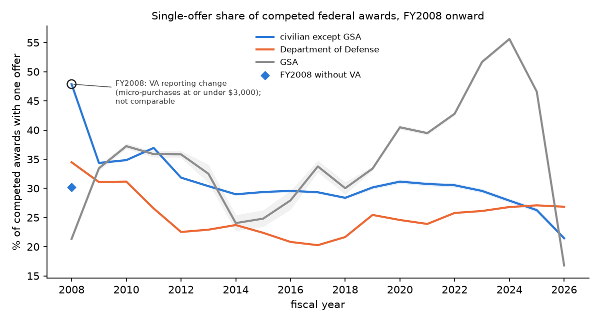

*What it cannot show:* whether competition itself changed or only how offers were recorded (agencies change their coding: see *Data quality* below). A Defense year is incomplete until its last quarter is published, 90 days late.
<!-- /auto:history -->

### 5. Does the pile-up follow the limit? Every change since FY2008

The simplified-acquisition limit moved from $100K to $150K in FY2011 and from $150K to $250K in 2018, when agencies switched on different dates. If the rule shapes behavior, each line's pile-up should grow when it becomes the limit and fade after.

<!-- auto:threshold-history -->
In FY2008–FY2021, the pile-up under a simplified-acquisition limit was larger in the years it was the limit than in the years it was not, for all 6 line-and-sector pairs that had both kinds of year. Bunching ratio on average: 1.47 against 1.15 for civilian agencies and 2.29 against 1.12 for Defense. At each of the 4 changes of the limit in these years (civilian and Defense counted separately), the pile-up under the new line grew and the one under the old line shrank, from the last year before the change to the first full year after it. The largest move: Defense under $250K, from 0.78 (0.70–0.88) in FY2017 to 2.00 (1.85–2.15) in FY2019 (95% intervals). The $350K limit is not in force in any of these years, so its change cannot be tested here yet. Finding 1 tests the move to $350K with the FY2024–FY2026 data.

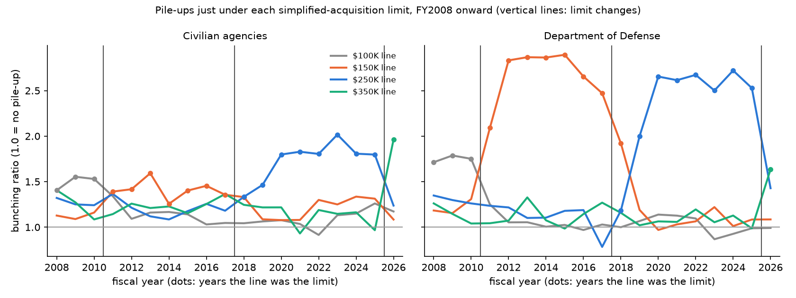
<!-- /auto:threshold-history -->

<!-- auto:threshold-staggered -->
**The 2018 change, agency by agency.** Civilian agencies raised the limit from $150K to $250K on their own dates (22 agencies with a documented date, from February 27, 2018 to January 7, 2020). Pooling the awards of civilian agencies (FY2016–FY2021) by quarter around each agency's own date, the ratio under $250K averaged 1.10 in the 8 quarters before the switch and 1.51 in the 9 quarters from it on. Its largest one-quarter rise came at quarter 0 (1.12 to 1.64). The 95% intervals of those two quarters (0.81–1.49 and 1.31–2.03) overlap, so the timing rests on the whole pattern, not on one quarter. Placebo: with every date moved one year earlier, the largest rise came at quarter +4, four quarters later, as a real effect predicts.

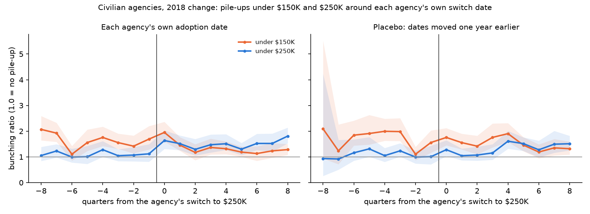

*What it cannot show:* why the pile-up follows the limit: budgets written to fit the rules, small-business rules tied to the line and contracts split to stay under it all look the same here. 7 of the 22 adoption dates are of medium confidence, and agencies without a documented date are left out.
<!-- /auto:threshold-staggered -->

### 6. A scan of every FAR dollar limit

The same test, run on every dollar limit in the Federal Acquisition Regulation where awards could pile up: micro-purchase, simplified acquisition, public posting, certified cost or pricing data, commercial items, subcontracting plans, justification approvals and the 8(a) limits. For each change, the pile-up "moved" when it grew under the new line relative to the old one (a difference-in-differences).

<!-- auto:threshold-scan -->
The scan measures pile-ups under 14 families of FAR dollar limits, fiscal year by fiscal year, in FY2008–FY2021. Of the 104 changes of a limit (civilian agencies and Defense counted separately), 33 can be tested with these years. In 12 of them the pile-up moved with the line (the 95% interval of the difference-in-differences is above zero): micro-purchase $3,500 to $5,000 (Defense); simplified acquisition $100K to $150K (civilian, Defense); simplified acquisition $150K to $250K (Defense); certified cost or pricing data $700K to $750K (Defense); certified cost or pricing data $750K to $2M (Defense); subcontracting plan $550K to $650K (civilian, Defense); justification approval, level 1 $650K to $700K (civilian); justification approval, level 1 $550K to $650K (Defense); 8(a) competition limit (not manufacturing) $3.5M to $4M (civilian, Defense). In 2 it moved the wrong way: micro-purchase $3,000 to $3,500 (civilian, Defense). The other 19 tested changes show no clear move. Of the 71 that cannot be tested, 18 need years before or after the data's range, 35 wait for fiscal years that are not in the data yet and 18 have too few awards near the line.

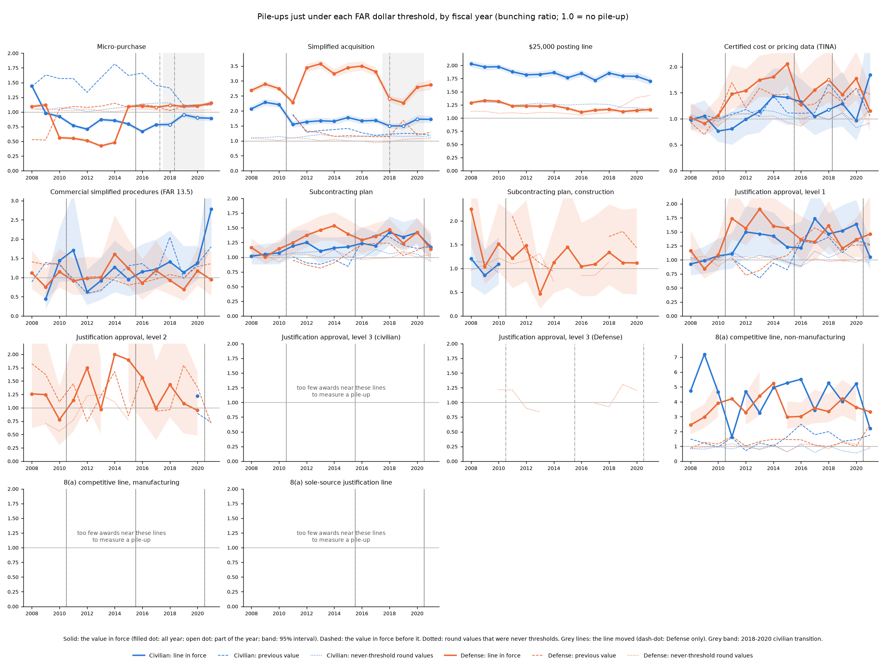

*What it cannot show:* why a pile-up forms. Many limits move on the same day, so a test of one change is confounded by the others, and round values attract awards everywhere.
<!-- /auto:threshold-scan -->

### 7. What goes with single offers

Which measurable circumstances go with a single offer, holding the agency and the year constant: what is bought, set-asides, how the award was competed, size, timing, the buying office's workload, the incumbent and the number of registered companies in the industry.

<!-- auto:drivers -->
In a model of 350,528 sampled competed purchase orders and definitive contracts (FY2011–FY2021), holding agency and sector × year constant, the clearest associations with a single offer (large and precisely measured) were: set-aside: service-disabled veteran-owned small business rather than no set-aside, −23.2 percentage points (−25.6 to −20.9); product/service category: product group 37: agricultural machinery rather than product group 53: hardware and abrasives, −26.2 percentage points (−34.2 to −18.1); industry (NAICS sector): 51: information rather than 31-33: manufacturing, +16.3 percentage points (+12.7 to +19.9). On awards held out of the fit (train FY2011-FY2020, test FY2021), the model ranks awards with an AUC of 0.729. Leaving out what is bought lowers it the most, by 0.044 (0.040 to 0.047).

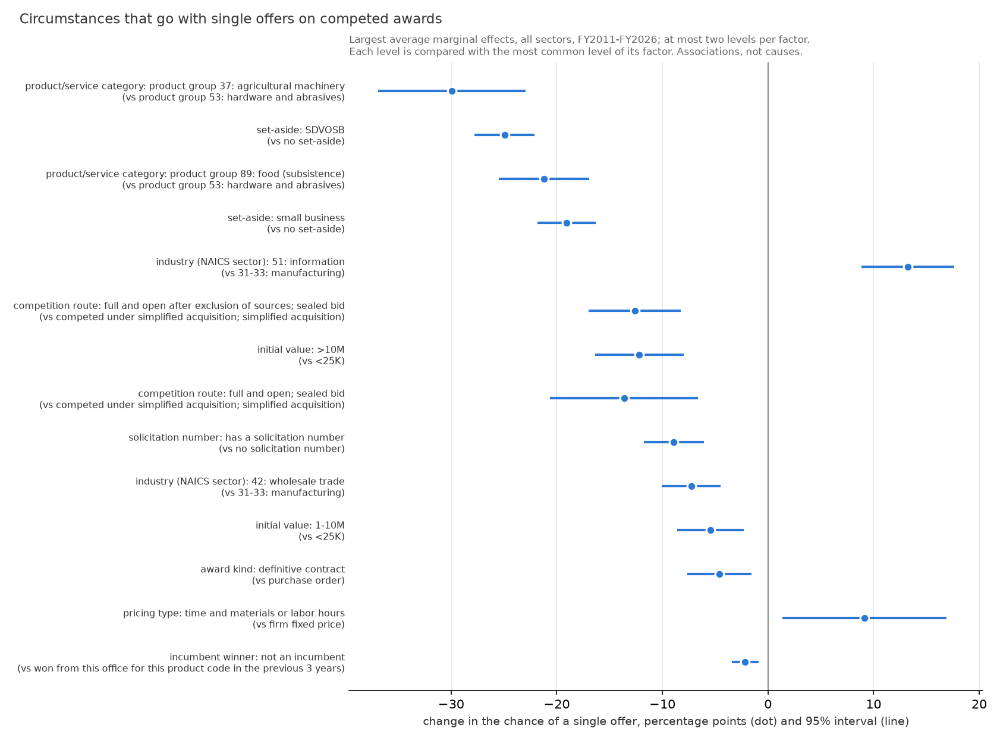

*What it cannot show:* causes. The factors travel together and with things the data do not record, and differences in how agencies code their data can look like drivers.
<!-- /auto:drivers -->

### 8. After award: do single-offer awards turn out differently?

Federal data has no unit prices, so the closest evidence is what happens after an award is made: money obligated, scope changes, terminations and options.

<!-- auto:outcomes -->
Single-offer and multi-offer awards were compared inside the same buying office, quarter, award type, product and size band: 333,302 competed purchase orders and definitive contracts (31% of the 1,068,615 awards of $25K or more) made in FY2008–FY2018, followed through the third fiscal year after award. Differences, single-offer minus multi-offer, in percentage points (95% interval): dollars obligated relative to the initial value: +1.57 (+0.85 to +2.30); awards obligated at 125% or more: −0.16 (−0.39 to +0.08); scope changes: −0.26 (−0.43 to −0.09); terminations: −0.46 (−0.65 to −0.28). Where the interval excludes zero, single-offer awards had slightly more dollars obligated relative to the initial value and slightly fewer scope changes and terminations, by at most 1.6 percentage points. The difference in awards obligated at 125% or more cannot be told apart from zero. Single-offer awards also differ slightly on things fixed at award (log of the initial value and planned length in years), so the cells do not make the two groups fully alike. The two placebo checks, which competition cannot affect (an even signing day and a coin flip), show no difference, as they should.

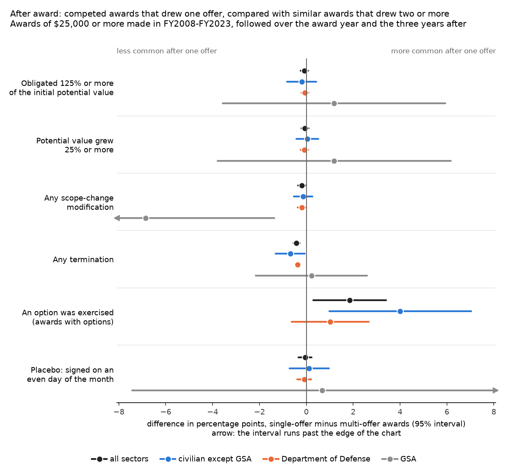

*What it cannot show:* prices, which the data do not hold, or whether extra obligations, scope changes or terminations were justified. Only awards in cells with both kinds of award carry the estimate. Total growth of an award's potential value is not in the yearly tables used here, so it is not measured.
<!-- /auto:outcomes -->

### 9. Purchases that look split

The FAR forbids splitting one requirement into several purchases just to stay under a limit. This screen looks for the pattern in the data and compares it with fake limits where no rule applies.

<!-- auto:split-screen -->
A split-like cluster is two or more purchases from the same company, office and product within 30 days, each at or under a limit but together above it. In FY2008–FY2021, the share of purchases at or under the limit that sit in such clusters, divided by what placebo lines predict (1.00 = no excess, 95% interval): at the simplified-acquisition limit, 1.07 for civilian agencies except GSA (1.05–1.11), 1.08 for GSA (1.04–1.14) and 1.13 for Defense (1.10–1.15); leaving out the awards within 10% of the limit, 1.04 for civilian agencies except GSA (1.02–1.09), 1.08 for GSA (1.04–1.14) and 1.04 for Defense (1.02–1.06). At the micro-purchase limit, 1.25 for civilian agencies except GSA (1.23–1.27), 1.06 for GSA (0.95–1.15) and 1.06 for Defense (1.05–1.07); without the awards within 10% of the limit, 1.08 for civilian agencies except GSA (1.06–1.10), 1.00 for GSA (0.91–1.09) and 1.02 for Defense (1.00–1.03). 10 of these 12 intervals lie above 1.00. When a limit rose, the excess in the band between the old and the new limit should fall. Of 11 such before-and-after tests, it fell clearly in 4, rose clearly in 0 and was unclear in 7; some of them use only part of their years after the change so far.

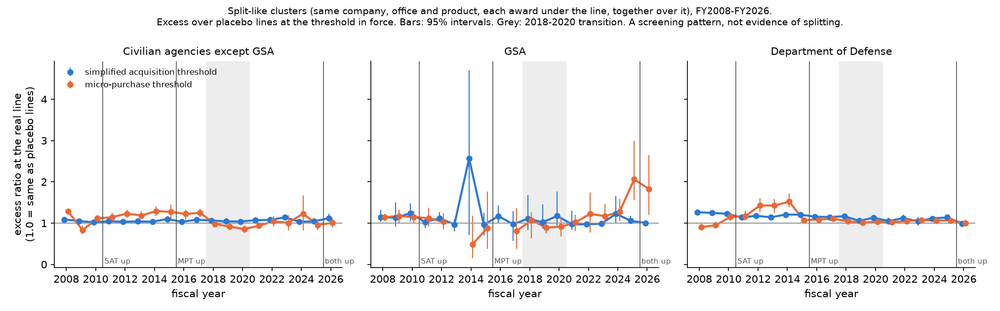

*What it cannot show:* a prohibited split from legitimate repeat buying, such as monthly supply orders. It is a screening pattern at sector level, not evidence that any purchase was split.
<!-- /auto:split-screen -->

### 10. Who wins the awards: the supplier base

How many different companies win new federal awards each year, how many are new, how many come back, how concentrated the dollars are, and how new companies relate to single offers. Only counts and shares are published; no company is named.

<!-- auto:supplier-base -->
In FY2008, 57,371 companies won at least one new award above $25,000. In FY2025, 44,466 did, 22% fewer. Counting every award, the number fell from 150,879 to 57,062, but much of that change is among companies with only small purchases, whose reporting changed over time (FY2008 includes 741,240 purchase orders of the Department of Veterans Affairs at or under $3,000); the above-$25,000 count is the steadier measure. Dollars are not adjusted for inflation. In an average year (FY2011–FY2021 and FY2025), 34% of the companies winning above $25,000 had won no such award in the three years before. These new companies won 13% of those awards and 14% of their initial dollars. About 48% of the companies won again the next year, and 63% within three years. The top 1% of companies won 65% of the initial dollars of purchase orders and definitive contracts above $25,000 in FY2025 (79% in FY2008). Pooled over FY2011–FY2021 and FY2025, competed awards won by new companies got a single offer less often than awards won by established companies: 21.0% (95% interval 20.8–21.2%) against 26.5% (26.4–26.6%). Years whose measures span the 2022 switch from DUNS to UEI company identifiers are marked not comparable until every table can link the two.

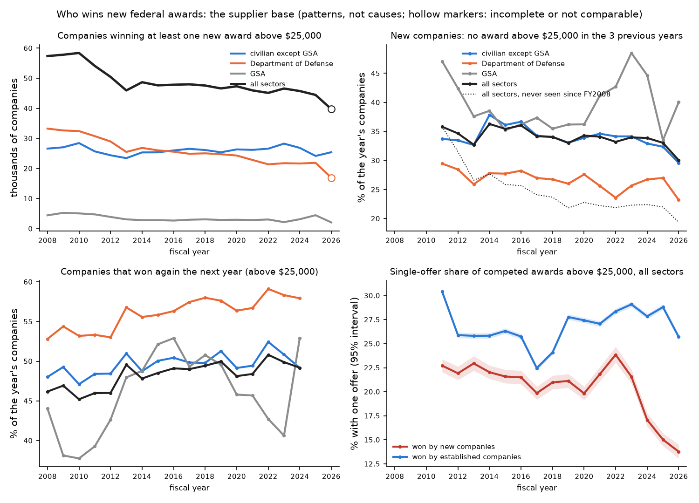

*What it cannot show:* why companies enter or leave, or whether fewer companies means less competition. A company here is one registered identifier: parents and subsidiaries count separately. Only prime awards are counted, and orders under existing contract vehicles are not in these tables. These are patterns, not proof of causes.
<!-- /auto:supplier-base -->

### Data quality and reference files

<!-- auto:quality -->
**Data quality.** `16_quality_monitor.py` looks for quarters in which an agency changed how it records its data. It compares each civilian agency, award type and quarter of the FY2024–FY2026 table with the quarters before it and flags only large, clear breaks. It flagged 85: 28 on the share of awards marked competed, 27 on award counts, 14 on the share with one offer, 6 on the share with three offers, 5 on the share with no usable offer count and 5 on the share with two offers. The largest change in offer coding: Department of Justice purchase orders in FY2024 Q4, where the one-offer share went from 28.6% to 57.4%. A flag means "check before you trust numbers from this agency and quarter". It cannot say whether the change is in coding, in late reporting or in competition itself. Full list: [`results/quality_flags.csv`](results/quality_flags.csv).
<!-- /auto:quality -->

<!-- auto:reconcile -->
**Completeness check.** `28_reconcile.py` compares our yearly transaction counts and dollars with USAspending's own totals. With the same filters as our downloads, FY2008–FY2023 (16 years checked) match USAspending's totals exactly. Awarding agencies missing from USAspending's top-tier agency list are not downloaded; they hold at most 0.29 percent of a year's transactions. Full table: [`results/reconciliation.csv`](results/reconciliation.csv).
<!-- /auto:reconcile -->

<!-- auto:reference -->
**Reference data.** [`reference/thresholds.csv`](reference/thresholds.csv) lists 108 value periods of 28 FAR dollar thresholds, each with its source and the words that show the value ([notes](reference/thresholds.md)). [`reference/threshold_adoption_2018.csv`](reference/threshold_adoption_2018.csv) gives the date each agency adopted the 2018 limits: 24 of its 33 rows (agencies and the FAR itself) have a date, from February 27, 2018 to August 31, 2020, 7 of them of medium confidence ([notes](reference/README.md)). [`reference/market_depth_naics.csv`](reference/market_depth_naics.csv) counts the companies registered in SAM.gov to compete for federal contracts in each industry code: 1,085 codes, a median of 842 companies per code, on November 1, 2026. A registration is not a capable bidder ([notes](reference/market_depth.md)).
<!-- /auto:reference -->

---

## Pre-registered forecasts

<!-- auto:forecasts -->
Forecasts were made on **2026-10-24** and fingerprinted with SHA-256 before any outcome was known. See [`forecasts/`](forecasts/).

| ID | What it forecasts | Resolves | SHA-256 |
|---|---|---|---|
| PIO-F1 | Probability of a single offer for each of 150 open civilian solicitations | 2027-03-31 (checks Jan 31 and Feb 28) | `a8d1bb3319bf2fc1439550ee99c971742408a99a4772db426b26dec15f0657d2` |
| PIO-F2 | FY2027 Q1 bunching ratios under $350K (2.03; 80% interval 1.40–2.66) and $250K (1.23; 0.88–1.58), plus the micro-purchase reporting share | 2027-02-28 | `5a7009ba0f17e953bd1fea32d2b7fe9241a849b85222266506c5312e4790c43b` |
<!-- /auto:forecasts -->

- The IDs start with "PIO" from the project's earlier working name (Procurement Integrity Observatory). The sealed files keep that name unchanged so their fingerprints still match.
- **PIO-F2** is published in full.
- **PIO-F1** includes office-level details, so only its fingerprint is published for now. The full file will be posted with the scoring. Anyone can then check it against the fingerprint above.

To verify a published forecast file:

```bash
sha256sum forecasts/PIO-F2-threshold-fy2027q1-20261024.json
```

<!-- auto:daily-forecasts -->
**Daily forecasts.** The daily series is built and tested; the first batch has not been sealed yet. When it starts, a robot will forecast each morning every new open solicitation on SAM.gov: the chance that its competed award gets only one offer, with forecast model version 2. A day's forecasts form one batch. The batch stays private, because it names solicitations and buying offices. Its SHA-256 fingerprint, a row of counts and short hashes of the solicitation numbers are made public in [`forecasts/daily/`](forecasts/daily/) the same morning, before any outcome exists. An award counts only if it is dated on or after the day offers were due. Scores are published as totals only. How it works: [`docs/daily-forecasts.md`](docs/daily-forecasts.md).
<!-- /auto:daily-forecasts -->

---

## How it works

One download serves every FY2024–FY2026 analysis, and the long history (findings 4 to 10) has its own yearly tables. All scripts are in `scripts/`; `run.py` runs them in the right order.

| Step | Script | What it does |
|---|---|---|
| 1 | `01c_download_civilian.py` | Contract transactions for every civilian agency, FY2024–FY2026, one request per quarter (USAspending download API, selected columns only) |
| older | `01_download_usaspending.py`, `01b_download_threshold_universe.py` | Older alternatives to step 1: the five departments one agency at a time, and purchase orders and definitive contracts for the threshold test |
| 2 | `02_build_awards.py` | One row per award, using the base action (modification 0): the five departments by default, every civilian agency with `--civilian` |
| 2b | `bunching_lib.py` | Builds the threshold test's base actions (`--rebuild`) and holds the bunching estimator |
| 3 | `03_atlas.py` | Single-offer shares for the five departments by department, year, award type, set-aside and size |
| 3b | `03b_atlas_civilian.py` | Single-offer shares for every civilian agency, with and without GSA |
| 4 | `04_threshold.py`, `04b_threshold_quarterly.py` | Bunching estimates with bootstrap intervals and placebo lines, for each period and each quarter |
| tool | `check_counts_sql.py` | Independent recount of the headline counts with SQLite and Python's csv module, no pandas |
| tool | `make_figures.py` | The charts in this README |
| tool | `build_report.py` | Writes every number in this README and in `docs/methodology.md` from the result files |
| 5–8, 11 | `05_sam_open_pull.py`, `06_sam_open_details.py`, `07_sam_train_lookup.py`, `08_model_forecast.py`, `11_resolution_backtest.py` | The forecast model, frozen from the October 24, 2026 build: open solicitations and response windows from SAM.gov, training, out-of-time test, live probabilities, resolution backtest. Its SAM.gov inputs were not kept, so these are not rerun |
| 10, 10b | `10_preregister.py`, `10b_preregister_threshold.py` | Created the sealed forecasts. Never rerun; they refuse to overwrite the sealed files |
| 9, 12, 13 | `09_resolve_forecast.py`, `12_resolve_threshold.py`, `13_track_threshold.py` | Scoring of PIO-F1 and PIO-F2 after they resolve, and a daily provisional check of PIO-F2 against the FY2027 Q1 data so far |
| 14 | `14_sam_daily_snapshot.py` | Saves SAM.gov's nightly list of active notices (contact details removed) and updates daily counts of open solicitations |
| 15 | `15_civilian_fytd.py` | Live single-offer table for every civilian agency, this fiscal year so far |
| 16 | `16_quality_monitor.py` | Flags quarters where an agency suddenly changed how it records offers, competition or award counts |
| 17, 18 | `17_history_download.py`, `18_history_build.py` | The long history: one fiscal year of transactions at a time (FY2008 onward, civilian agencies and Defense), turned into two yearly tables, one row per base award and one row per award per year of later actions. They run on GitHub's computers (`.github/workflows/history.yml`) and the tables are published as a public release of this repository |
| 19 | `19_history_atlas.py` | Single-offer shares since FY2008 for civilian agencies except GSA, GSA and Defense |
| 20, 21 | `20_threshold_history.py`, `21_threshold_staggered.py` | Pile-ups under every simplified-acquisition limit since FY2008, and the 2018 change agency by agency with its placebo |
| 22 | `22_sam_archive.py` | Turns SAM.gov's yearly archive files of past notices into small tables of solicitations (no names, no contacts), the training data of forecast model version 2 |
| 23 | `23_drivers.py` | What goes with single offers: shares by factor, a model with agency and year controls, and how much each block of factors explains |
| 24 | `24_outcomes.py` | After award: single-offer versus multi-offer awards in the same office, quarter, product and size, with placebo checks |
| 25 | `25_market_depth.py` | Registered companies per industry code, from SAM.gov's public entity extract (counts only) |
| 26 | `26_split_screen.py` | Split-like purchase clusters, compared with placebo lines |
| 27 | `27_threshold_scan.py` | Pile-ups under every FAR dollar limit, with placebo values and a before-and-after test of each change |
| 28 | `28_reconcile.py` | Compares our yearly transaction counts and dollars with USAspending's own totals for the same filters |
| 30 | `30_model_v2.py` | Forecast model version 2, trained on SAM.gov's archive: the model of the daily forecasts |
| 31, 32 | `31_daily_forecast.py`, `32_score_daily.py` | The daily sealed forecasts: each morning, forecast the new open solicitations and seal the batch (batch private, fingerprint public); later, score them (totals only). See [`docs/daily-forecasts.md`](docs/daily-forecasts.md) |
| 33 | `33_supplier_base.py` | Who wins the awards: companies, new companies, staying and concentration (counts and shares only) |
| tool | `build_dashboard.py`, `build_explorer.py`, `build_brief.py` | The [public dashboard](https://e-burress.github.io/federal-contract-competition/) (`docs/index.html`), the data behind the explorer (`docs/explorer.html`) and the [one-page brief](https://e-burress.github.io/federal-contract-competition/brief.html) (`docs/brief.html`) |
| tool | `run.py` (in the repository root) | Runs the steps above in order. See below |

**Data behind the long history.** The yearly tables (`base_actions_FY<year>.parquet` and `award_year_FY<year>.parquet`) are published as a public release of this repository; `python run.py history` downloads them and rebuilds findings 4 to 10. The SAM.gov archive tables (from `22_sam_archive.py`) hold solicitation numbers, dates, codes and two keyword flags, never titles, descriptions, names or contacts. The reference files (`reference/`) are described under *Data quality and reference files* above.

**Scoring the sealed forecasts.** [`docs/scoring-forecasts.md`](docs/scoring-forecasts.md) explains, for a person and not a programmer, how PIO-F1 is scored with `python run.py score-f1` and how the daily job scores PIO-F2. No AI is needed or used.

A GitHub Actions job (`.github/workflows/daily-refresh.yml`) runs steps 14, 15 and 13 and the dashboard build every morning and publishes the result. It checks the sealed PIO-F2 fingerprint on every run and never changes the forecast files. The full daily SAM.gov snapshots are kept in draft (non-public) releases of this repository; the daily counts in `results/sam_daily_counts.csv` are public.

Details, definitions and data-quality notes are in [`docs/methodology.md`](docs/methodology.md).

### Run it yourself

You need Python 3.11 or newer. One command rebuilds everything:

```bash
pip install -r requirements.txt
python run.py quick
```

With [uv](https://docs.astral.sh/uv/), one line installs the right Python and packages and runs it: `uv run run.py quick`.

| Command | What it does |
|---|---|
| `python run.py check` | Checks your Python, packages and folders |
| `python run.py quick` | Downloads the published data snapshot and rebuilds every result, chart, the numbers in this README and the dashboard. Takes minutes |
| `python run.py all` | Rebuilds everything from the government sources. Slow, mostly waiting on downloads |
| `python run.py verify` | Compares your results with the published ones |
| `python run.py test` | Runs the offline tests |
| `python run.py daily` | The morning refresh: SAM.gov snapshot, this fiscal year so far, forecast tracking, dashboard |
| `python run.py history` | Downloads the yearly tables of the long history (FY2008 onward) and rebuilds findings 4 to 10. Then `python run.py report` writes their numbers into this README |
| `python run.py score-f1` | Scores the sealed single-offer forecast (PIO-F1) once its private file is posted. See [`docs/scoring-forecasts.md`](docs/scoring-forecasts.md) |
| `python run.py reconcile` | Compares our yearly totals with USAspending's own totals (needs the history tables and the internet) |
| `python run.py brief` | Rebuilds the one-page brief (`docs/brief.html`) |
| `python run.py daily-forecast` | Forecasts and seals the day's new open solicitations. Needs the private model file; add `--dry-run` to write nothing public. See [`docs/daily-forecasts.md`](docs/daily-forecasts.md) |
| `python run.py score-daily` | Scores the sealed daily forecasts and writes the totals to `results/daily_forecast_scores.json` |

No coding needed: open the project in GitHub Codespaces with the button at the top and type `python run.py quick`. Step-by-step instructions for every route (Codespaces, your own self-refreshing copy, double-click launchers) are in [`docs/run-it-yourself.md`](docs/run-it-yourself.md).

The scripts that created the sealed forecasts (10 and 10b) and the frozen forecast model (05–08 and 11) are never part of any command.

---

## Limits

- **No unit prices.** Federal award data records dollar values, not quantities or unit prices, so the price premium of single-offer awards can't be measured directly. <!-- auto:limit-premium -->A preliminary check found single-offer awards are 27% *smaller* within comparable categories, and found only small differences, in both directions, in dollars obligated after award relative to the initial value.<!-- /auto:limit-premium -->
- **Offer counts are entered by staff.** In the five departments, <!-- auto:limit-999 -->760 competed awards<!-- /auto:limit-999 --> carry a "999" placeholder and were excluded.
- **FY2026 is unusual.** It saw a government shutdown, a reporting-system move and staffing changes. <!-- auto:limit-fy2026 -->HHS and VA competed-award counts fell 34–50% from FY2024 to FY2026.<!-- /auto:limit-fy2026 -->
- **SAM.gov's public search endpoint is undocumented.** This project uses it politely, at about one request per second. The documented alternatives are SAM's API (key required) and its daily CSV extract.
- **Coverage:** every civilian agency for single-offer shares; five departments for the deeper analysis and the forecasts. DoD is left out of the FY2024–FY2026 tables and included in the long history (findings 4 to 10).
- **GSA's supply orders** dominate civilian award counts and changed how they record offers, so civilian-wide figures are also given without GSA.
- **Defense data arrive 90 days late.** The newest Defense year is incomplete until its last quarter is published. Scripts that need a full year leave an incomplete Defense year out and say so.
- **The history tables are still being filled in.** <!-- auto:limit-history -->The single-offer history uses FY2008–FY2021 so far; FY2022–FY2026 are still to come.<!-- /auto:limit-history --> Each of findings 4 to 10 names the years it uses. Agencies change how they record offers and competition (see *Data quality*), so a change over time can be a change in recording.
- **Company codes are not anonymous.** The history tables carry a short company code made from each company's public identifier (UEI or DUNS), so the same company can be followed across awards. Anyone with the identifier can compute the same code, contract numbers are kept, and the underlying records are public on USAspending.gov. A company that switched from DUNS to UEI in 2022 can have two codes. Published results are at agency level or coarser.
- **After award, not prices.** The after-award comparison (finding 8) measures obligations, scope changes, terminations and options, not prices. Extra obligations and scope changes are often legitimate.
<!-- auto:model-v2 -->
- **Forecast model, version 2 (built November 10, 2026).** It is the model of the daily forecasts (see *Pre-registered forecasts*). Trained on 656,878 solicitations from SAM.gov's archive that were matched to a competed award (award years FY2008–FY2021; its award history ends September 30, 2021). Tested out of time on FY2009–FY2021, the shipped L2 logistic regression ranks solicitations with an AUC of 0.692 (0.583 for the best simple baseline, the buying office's past rate, and 0.681 for version 1's features refitted), with a Brier score of 0.160 against 0.179 for that baseline and a calibration slope of 0.95 (1.00 is ideal). Its award history ends more than 9 months before it was trained, so it must not score live solicitations until it is retrained on newer award years; the daily forecast script refuses a model this old. Version 1 (finding 3) is the earlier model, frozen since the October 24, 2026 build. Both are risk indicators about markets, not statements about anyone's conduct. Details: [`results/model_v2_card.json`](results/model_v2_card.json).
<!-- /auto:model-v2 -->

## Responsible use

These numbers describe **markets and procurement patterns, not people**. A high single-offer rate or a pile-up under a threshold is a signal worth a closer look. It is not evidence of wrongdoing, and many have ordinary explanations. No individuals are named or stored. Contact details in SAM.gov records are never saved.

Office-level tables are left out of this first release until the method has been reviewed by a procurement practitioner.

Found an error? Please [open an issue](../../issues).

## Data sources

- [USAspending.gov](https://www.usaspending.gov) API and download service (US Treasury; public domain)
- [SAM.gov](https://sam.gov) contract opportunities (GSA; public)
- [Federal Acquisition Regulation](https://www.acquisition.gov/far) threshold history

## About

Built by **Ellie Burress** with AI assistance: Claude Code (an AI coding assistant) wrote most of the code and analysis for this first version. Questions, corrections and suggestions are welcome.

**License:** code under the [MIT License](LICENSE). Text, figures and result tables under [CC BY 4.0](https://creativecommons.org/licenses/by/4.0/). The underlying government data is in the public domain.
